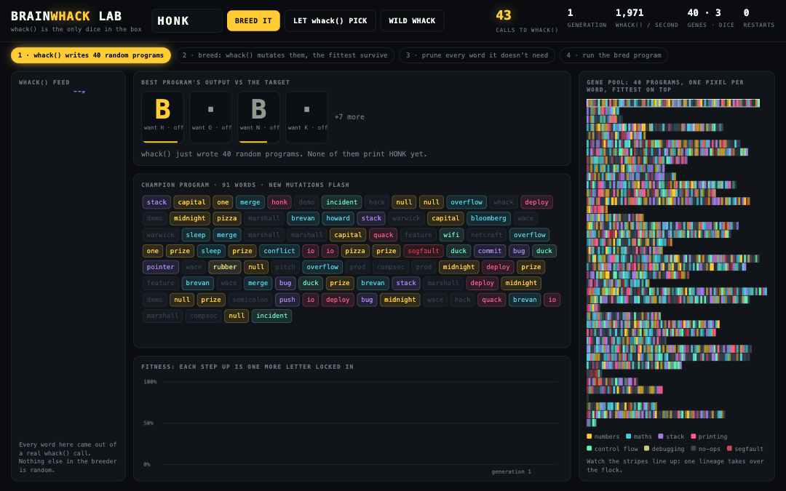
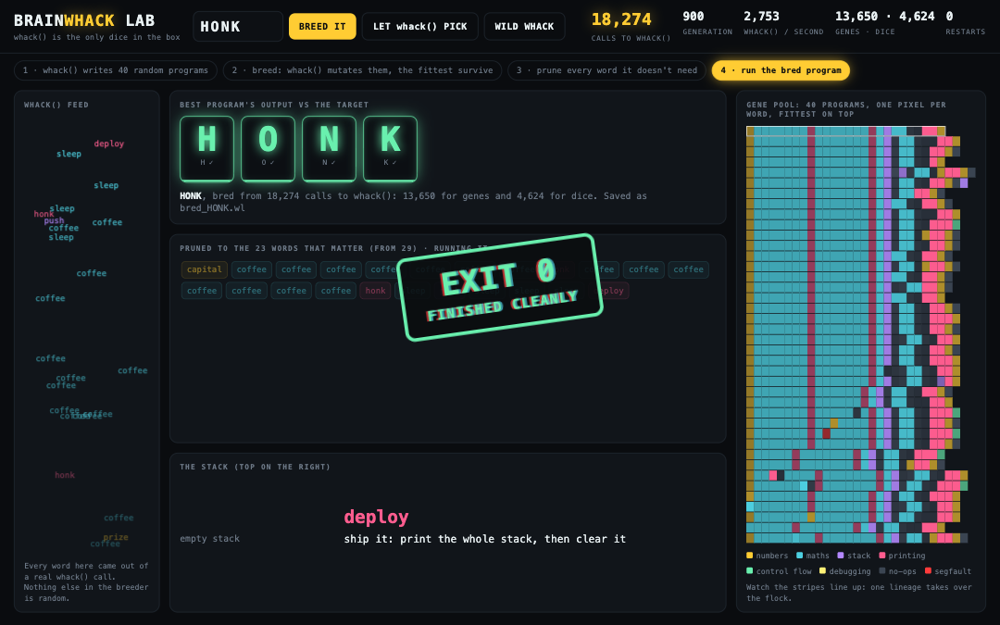

# BrainWhack

**Every whack() output is a valid program. Most of them crash. I bred one that says HONK.**

BrainWhack won the WHACK 26 One Hour Hack at the University of Warwick on 7 November 2026. Everyone got the same function, `whack()`, and one hour to build the most creative thing around it. BrainWhack turns whack() into a programming language, then uses whack() as the only source of randomness in a genetic algorithm that breeds a program to print HONK.

**Try it online: [brainwhack.vercel.app](https://brainwhack.vercel.app/?breed=HONK)**



## Quick start

Python 3.9 or newer, standard library only. Nothing to install.

```
python3 brainwhack.py evolve HONK        # breed a program that prints HONK, live in the terminal
python3 brainwhack.py run bred_HONK.bw   # run any BrainWhack program
python3 brainwhack.py trace bred_HONK.bw # step through it one word at a time, with the stack
python3 brainwhack.py census             # run 1,000 wild whack() programs and see what lives there
python3 brainwhack.py evolve             # let whack() choose what to breed
python3 brainwhack.py ops                # the instruction set
python3 whack_lab.py                     # the lab: open http://localhost:8026/?breed=HONK
```

## The challenge

The organisers gave everyone the same function, `whack.py`, in 13 languages. Each call:

1. picks a random number from 1 to 100,
2. writes that many lines to a file called `whack`, each one a random word from a fixed list of 42 (WHACK, the sponsors, ducks, geese and some classic hackathon suffering),
3. returns the words it wrote.

The rules: call `whack()` but never change it, make it the star, work solo, keep it harmless, and open a pull request before midnight. Judging was on creativity, how central `whack()` is, and fun. `whack.py` in this repo is the organisers' file, byte for byte.

## The language

BrainWhack is an esoteric programming language in the Brainfuck tradition, except that the 8 symbols are replaced by the 42 words whack() knows. Each word is one instruction for a small stack machine that works on bytes (0 to 255, wrapping), so `capital` pushes 65, `coffee` adds 1, `honk` prints the top of the stack as a letter, and `duck … goose` is a loop. Some of the sponsors are no-ops.

Since every word means something, there is no such thing as a syntax error. Every file whack() has ever written is a runnable program. A few rules make random code survivable:

- Popping an empty stack gives 0 instead of an error.
- An unmatched `duck` or `goose` does nothing.
- Programs stop after 5,000 steps, so infinite loops are harmless.

Most wild programs loop forever, print garbage, or segfault. `census` runs 1,000 of them:

| What 1,000 wild whack() programs do | Share |
|---|---|
| Died of a segfault | about 60% |
| Exited cleanly | about 32% |
| Looped forever | about 7% |
| Printed anything at all | about 74% |

None of them say HONK.

### The 42 words

| Word | Kind | What it does |
|---|---|---|
| `whack` | noop | no-op |
| `hack` | noop | no-op |
| `duck` | control | loop start |
| `quack` | output | print top as a character, then pop it (ducks quack and leave) |
| `goose` | control | if top isn't 0, fly back to the matching duck |
| `honk` | output | print top as a character (geese honk and stay) |
| `bug` | stack | swap the top two |
| `feature` | noop | no-op (it's not a bug) |
| `warwick` | noop | no-op (sponsor slot: does nothing, looks great on the slide) |
| `oculus` | noop | no-op (sponsor slot: does nothing, looks great on the slide) |
| `compsoc` | noop | no-op (sponsor slot: does nothing, looks great on the slide) |
| `marshall` | noop | no-op (sponsor slot: does nothing, looks great on the slide) |
| `wace` | noop | no-op (sponsor slot: does nothing, looks great on the slide) |
| `brevan` | math | top * 2 |
| `howard` | math | top / 2 |
| `capital` | literal | push 65 (capital A) |
| `one` | literal | push 1 |
| `bloomberg` | math | push the sum of the whole stack |
| `netcraft` | noop | no-op (sponsor slot: does nothing, looks great on the slide) |
| `incident` | control | if top is 0, skip the next word |
| `io` | output | print top as a number |
| `pizza` | literal | push 8 (slices) |
| `coffee` | math | top + 1 |
| `sleep` | math | top - 1 |
| `deploy` | output | ship it: print the whole stack, then clear it |
| `merge` | math | pop b, a; push a + b |
| `conflict` | math | pop b, a; push a - b |
| `commit` | stack | drop top |
| `push` | stack | duplicate top |
| `prod` | noop | no-op (works on my machine) |
| `segfault` | control | halt: Segmentation fault (core dumped) |
| `null` | literal | push 0 |
| `pointer` | stack | rotate the third item to the top |
| `stack` | stack | push the stack depth |
| `overflow` | math | pop b, a; push a * b (wraps at 256) |
| `semicolon` | noop | no-op (optional, like in JavaScript) |
| `rubber` | debug | rubber duck debugging: print what's on the stack |
| `demo` | noop | no-op (demo mode) |
| `pitch` | noop | no-op |
| `prize` | literal | push 100 |
| `midnight` | literal | push 12 |
| `wifi` | control | skip the next word (packet dropped) |

Two pairs are deliberately different. `honk` prints the top of the stack and leaves it there: geese honk and stay. `quack` prints it and pops it: ducks quack and leave. `wifi` skips the next word because the packet dropped.

## The breeder

The breeder gets around the garbage by evolution rather than by writing the program.

**whack() is the only randomness.** `brainwhack.py` never imports `random`. A small class, `WhackRandom`, reads every word whack() writes as a digit in base 42 and builds fair dice from those digits with rejection sampling. Every random decision in the breeder (which parent, which mutation, where to cut, how to break ties) comes from these dice. The lab page has no randomness of its own either: falling words are spaced with the golden ratio.

**whack() is the alphabet.** The starting population is 40 raw whack() outputs, used as programs.

**whack() is the mutation operator.** Each generation keeps the fittest 10 of 40, and whack() makes 30 children from them with one of four mutations:

- **Splice:** a few words from a fresh whack() replace a few words in the parent.
- **Point mutation:** one word is swapped for a word from a fresh whack().
- **Crossover:** the front of one parent joins the back of another, cut at the same place.
- **Deletion:** one or two words are removed.

The lab and dashboard count the calls separately: "genes" are whack() calls used as program material, and "dice" are calls used for decisions. A typical HONK breed makes 10,000 to 20,000 calls.

**Fitness is a staircase.** A program scores 1,000 points for each correct leading letter, plus up to 256 for how close the next letter is. Once every letter is right, extra output costs points. Elitism means a locked-in letter is never lost, so the output tiles turn green from left to right. Among equal scores, programs that halt beat programs that loop, and whack() breaks the remaining ties so the flock can drift.

**Restarts and limits.** If the best score hasn't improved for 700 generations, the goose scatters the flock and breeding restarts from fresh whacks ("honk!" on the chart). Breeding gives up after 60 seconds, which in practice it rarely needs.

**Pruning.** The winner is pruned by deleting every word it still works without, then saved as `bred_TARGET.bw` with its generation and whack() call counts in the header.

### The bred program

`bred_HONK.bw` took 900 generations and 18,274 calls to whack() (13,650 for genes and 4,624 for dice), in 6.6 seconds. This is `python3 brainwhack.py trace bred_HONK.bw`:

```
step  word      stack (top on the right)    output      what happened
   1  capital   65                          ''          push 65 (capital A)
   2  coffee    66                          ''          top + 1
   3  coffee    67                          ''          top + 1
   4  coffee    68                          ''          top + 1
   5  coffee    69                          ''          top + 1
   6  coffee    70                          ''          top + 1
   7  coffee    71                          ''          top + 1
   8  coffee    72                          ''          top + 1
   9  honk      72                          'H'         prints 'H'
  10  coffee    73                          'H'         top + 1
  11  coffee    74                          'H'         top + 1
  12  coffee    75                          'H'         top + 1
  13  coffee    76                          'H'         top + 1
  14  coffee    77                          'H'         top + 1
  15  coffee    78                          'H'         top + 1
  16  coffee    79                          'H'         top + 1
  17  honk      79                          'HO'        prints 'O'
  18  sleep     78                          'HO'        top - 1
  19  push      78 78                       'HO'        duplicate top
  20  sleep     78 77                       'HO'        top - 1
  21  sleep     78 76                       'HO'        top - 1
  22  sleep     78 75                       'HO'        top - 1
  23  deploy                                'HONK'      ship it: print the whole stack, then clear it

Output 'HONK', then exited cleanly.
```

It honks H and O, then pushes a copy of the top, counts the copy down to K, and `deploy` ships the whole stack, printing N and K in one go. Nobody designed that: it is what survived.

The target is HONK because the first program in a goose language should be Hello World for geese, and because anyone who has crossed Warwick's campus knows who actually runs it.

## The lab



`python3 whack_lab.py` starts a local server on port 8026 (set `PORT` to change it). The breeder runs in Python and streams every generation to the page with server-sent events, about 20 frames a second. The page never calls whack() itself: every word it shows came from Python.

- **whack() feed:** words fall as whack() calls happen.
- **Output vs target:** one tile per letter, green when locked in, with how far off each letter is.
- **Champion program:** the best program as coloured words, with new mutations flashing.
- **Gene pool:** all 40 programs as rows of pixels, one pixel per word, fittest on top. As one lineage takes over, the stripes line up.
- **Fitness chart:** the staircase, with a "honk!" marker at every restart.
- **Phase bar:** whack() writes 40 programs, breed, prune, run.
- **Finale:** the winner is pruned word by word, then runs one instruction at a time with a live stack. It ends with an "exit 0" stamp, or a screen shake and a red "Segmentation fault (core dumped)" stamp.

The hosted version at [brainwhack.vercel.app](https://brainwhack.vercel.app) works slightly differently. Vercel functions can't stream, so `api/lab.py` runs each breed in full on the server in one request, at full speed, from `/tmp` (the only writable folder there, where whack() writes its file). The page then replays the sampled generations at a watchable pace. Locally, every generation streams live.

The buttons breed whatever you type, let whack() pick the target, or run one wild whack() program. Add `?breed=HONK` to start breeding on load, and `?fast` for full speed instead of the watchable pace.

## How the hour went

| Time | What happened |
|---|---|
| 22:30 | Hacking starts. Brainstormed twelve ideas for whack(). |
| 22:50 | Built five hacks: WhackLang, a Proof of Whack blockchain, a casino, a drum machine and a map. |
| 23:00 | Added free, keyless APIs to three of them: drand, mempool.space, Open-Meteo and Wikipedia. |
| 23:18 | Dropped the other four to focus on WhackLang alone. Rewrote the breeder with whack() as its only randomness. |
| 23:20 | Built the lab. Breeding was too slow: HONK and DUCK took over 40 seconds, or never finished. |
| 23:28 | Fixed evolution: `quack` pops, crossover cuts both parents at the same place, staircase fitness. HONK dropped to about 4 seconds. |
| 23:32 | Pull request opened. |
| 23:36 | Added the GIF and screenshot, a 60-second cap, and re-bred HONK. |
| 23:38 | Renamed WhackLang to BrainWhack. Rewrote the README. |
| 23:43 | Re-recorded the demo at a watchable pace with a phase bar and a sharper GIF. |
| 23:48 | Renamed the files to `brainwhack.py` and `.bw`. Added `census` and `trace` to the README. |
| 23:51 | Full test sweep on Python 3.9 and 3.13: friendlier errors for missing files, unknown commands and a busy port. |
| 23:55 | Last push. |

The biggest lesson was the fitness function. The first breeder scored all letters at once, and because printing never consumed the value, every letter depended on the ones before it. Fixing one letter broke the next, and restarts wiped out near-solutions:

| Breeder version | Time to breed HONK |
|---|---|
| Splice-only mutations, all letters scored together | about 85 seconds |
| Four mutations, whack() as the only dice, same fitness | over 40 seconds, sometimes never |
| `quack` pops, aligned crossover, staircase fitness | about 4 to 6 seconds |

## The other four hacks

Before focusing on BrainWhack, the first half hour produced four other hacks. They are in `extras/`, unchanged from that point. They use free APIs that need no keys and still run offline without the live parts.

```
cd extras
python3 proof_of_whack.py      # a blockchain where mining means calling whack()
python3 whack_casino.py odds   # a slot machine with exactly computed odds
python3 whack_casino.py        # play it: every pull is seeded by a public randomness beacon
python3 whack_server.py        # then open http://localhost:8026 for the drum machine and the map
```

- **Proof of Whack:** each block's hash picks a phrase of whack words, and a miner must call whack() until its output contains that phrase. The first block is anchored to the latest real Bitcoin block, and at the end it compares its whacks per second with Bitcoin's live hashrate.
- **Whack Casino:** the reels scroll through the real `whack` file and stop on its first three lines. The paytable's odds are exact, with a house edge of 4.61%. Every pull is provably fair: it is seeded by the drand randomness beacon, and the game prints a command to replay any pull.
- **Whack Machine:** every whack() call is a drum loop. Each word is a beat (`segfault` is a kick, `conflict` a snare), birds sing the melody, and the word count sets the tempo.
- **Whack Atlas:** each word is a real place chosen by pun (`null` is Null Island, `segfault` the San Andreas Fault), and a duck flies the route with live weather and a Wikipedia postcard at every stop.

## Files

| File | What it is |
|---|---|
| `brainwhack.py` | The language, the breeder, and every terminal command |
| `whack_lab.py` | The lab's server: streams the breeder to the browser |
| `index.html` | The lab page |
| `whack.py` | The organisers' whack() function, unchanged |
| `bred_HONK.bw`, `bred_WHACK.bw` | Programs the breeder made |
| `demo.gif`, `screenshot.png` | The lab in action |
| `api/lab.py`, `vercel.json` | The hosted version on Vercel |
| `extras/` | The four earlier hacks |

The hackathon submission itself is [pull request #4 on WarwickHack/one-hour-hack-26](https://github.com/WarwickHack/one-hour-hack-26/pull/4).

Built by Arnav Popley. `whack()` by the WHACK 26 organisers.
